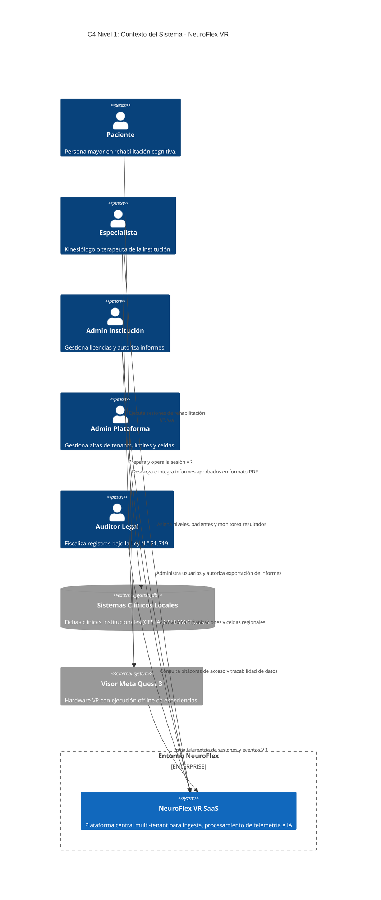

# Documento de Arquitectura de Software (SAD)
## Plataforma SaaS NeuroFlex VR

**Fecha:** Octubre 2026  
**Modalidad:** Innovación / Desarrollo  
**Repositorio:** `prxska/neuroflex-infra`  

---

### 1. Contexto de Negocio y Alcance Clínico

#### 1.1. Problemática
En Chile, la población de 60 años o más aumentará del 18,1% al 32,1% (INE). La prevalencia de demencia es significativamente mayor en zonas rurales (10,3%) frente a zonas urbanas (6,3%), y apenas 28 de cada 100 personas detectadas logran mantener su tratamiento continuo.

#### 1.2. Solución Propuesta
NeuroFlex VR es una plataforma SaaS diseñada para ejercitar y evaluar la memoria y la atención mediante realidad virtual en centros como CESFAM, ELEAM y clínicas privadas. La arquitectura garantiza tolerancia a conexiones inestables, almacenamiento inmutable y aislamiento estricto entre instituciones médicas bajo el marco de la Ley N.º 21.719.

* **Modelo Comercial:** Suscripción mensual de referencia de USD 300 por institución.
* **Meta FinOps de Infraestructura:** Costo operativo de USD 1,6 por institución/mes y USD 0,009 por sesión clínica procesada.

---

| Sprint | Enfoque Principal | Entregables Clave |
| :--- | :--- | :--- |
| **Sprint 1** | Fundaciones de Arquitectura y Legalidad | Planos C4 (Nivel 1 y 2), ADR de arquitectura celular y matriz Ley 21.719. |
| **Sprint 2** | Infraestructura Core Celular (IaC) | Módulos Terraform de API Gateway, SQS, Lambda y DynamoDB multi-tenant. |
| **Sprint 3** | Aislamiento Multi-Tenant y Seguridad | Roles Cognito, validación STS por tenant, KMS por cliente y S3 Object Lock. |
| **Sprint 4** | Despliegue Multi-Región y Gobernanza | Configuración multi-región (`sa-east-1` y failover), Step Functions y WAF/CloudTrail. |
| **Sprint 5** | Pruebas de Carga y Aislamiento | Pruebas k6 (1.000 visores y 300 profesionales concurrentes; p95 < 500 ms). |
| **Sprint 6** | FinOps, CI/CD y Manuales Operativos | Pipeline GitHub Actions, análisis de costos para 10, 50 y 100 clientes y manuales[cite: 17]. |

---

### 3. Modelo de Arquitectura: C4 Nivel 1 (Contexto del Sistema)

